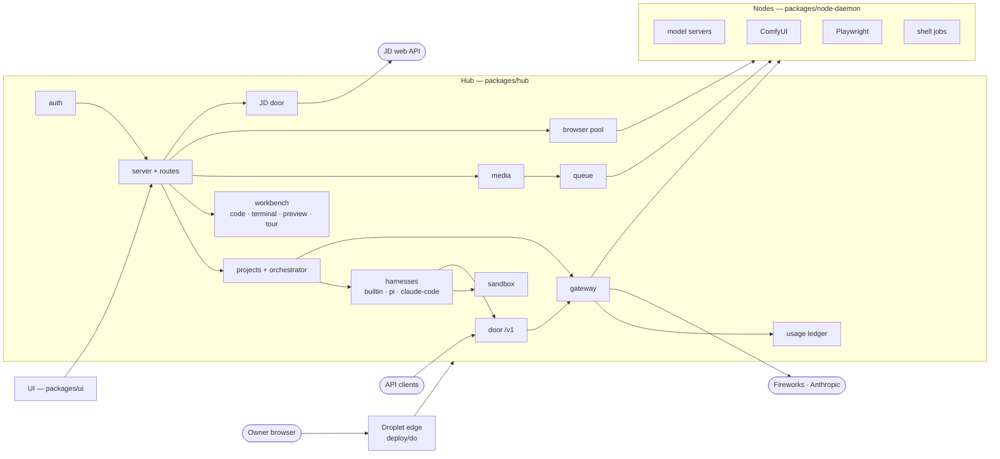

# AgentHub — architecture map

A map, not a manual: per module its purpose, entry file and decisions (`docs/decisions/NNNN`).
Detail lives in the code's comments and the decision records; a line here is only what you need to
work in a module and would not find there.

## Packages

**`packages/shared`** (`src/index.ts`) — the wire types both ends compile against, plus
`shell-task.ts` (`runShellTask`, `secretsStripped`) and `tour.ts`. Nothing else here does I/O.

**`packages/mocks`** — strict OpenAI-compatible mock, ComfyUI mock, JD web API mock
(`@agenthub/mocks/jd`), daemon-config writer. Keep the mocks strict: a lenient one once hid a broken
wire format behind 650 green tests.

**`packages/hub`** (`src/main.ts` → `server.ts`) — the one long-running process: Fastify + SQLite,
API, UI bundle, WebSocket, queue, gateway, projects. It reaches nodes only through what they
register (0003).

**`packages/hub/sim`** (`sim.ts`) — `npm run sim` / `sim:ui` (0051): the hub in-process on mocks,
`agent-script.ts` playing every agent, three seeded projects. Dev tooling: nothing in `src/` imports it.

**`packages/node-daemon`** (`src/main.ts` → `daemon.ts`) — one per machine: registers serving
entries (spawned or attached, 0005), shell jobs, a browser, heartbeats, claims and runs jobs; exits on
410; per-node token (0016). `video-gen.ts` is the ComfyUI client for both media job types.

**`packages/ui`** (`src/main.ts`) — Vite + vanilla TS, no framework (0048, 0053). Store fed by
`/api/state` and the socket; rail plus one page per place (`pages/`). Machines keeps the old
`cluster`/`computer`/`allocation` page ids. Pure model files are node-tested, DOM parts happy-dom
(0052). CodeMirror and xterm load lazily (0043, 0041).

**`ui/src/pages/jd.ts`** + **`ui/src/jd.ts`** — the JD page (0071). JD's HTML is rebuilt from an
allow-list (`renderJdText`), never `innerHTML`.

**`ui/src/panels/docshell.ts`** — the docs shell (0047) for Docs, the PRD and Help: `page` mode swaps
documents, `scroll` mode shows them all. Help (`pages/help.ts`) feeds it `docs/guide/*.md`.

## Hub (`packages/hub/src`)

**`auth.ts`** — sessions, daemon bearers, `routeAccess` (every route `open`/`daemon`/`door`/
`assistant`/`owner` by table; unknown denies). Assistant tokens get an allow-list (0065, 0067);
`sameOriginWrite` is the CSRF guard (0040); node tokens act only for their node (0016).

**`door.ts`** — the OpenAI-compatible `/v1` door and user API tokens (sha256 only). Model names are
the tiers plus a route suffix (0050); the token's kind sets priority (0020, 0035) and its label the
ledger subject (0034). `pi:` tokens are reserved for harness runs.

**`gateway.ts`** + **`providers/`** — the only place a model is called: picks an endpoint per tier and
route, fails over, applies switched-off models, the cloud cap and paused nodes (0002, 0006, 0008,
0019, 0024, 0054), prices each request. `providers/fireworks.ts` holds the only price table (0026).

**`node-registry.ts`**, **`db.ts`**, **`queue.ts`** — nodes, SQLite schema (`ensureColumn`
migrations), priority job queue with fencing and requeue-on-offline.

**`enrollment.ts`** — one-time enrollment tokens; serves `/install.sh` and the hub's own source so
nodes need no repo access (0016).

**`usage.ts`** — the cost ledger, one row per model request; `usd` NULL when unpriced, $0 local
(0022–0024). Complete only because every model call runs through `AgentLoop`; keep it that way.

**`agents/`** (`loop.ts`) — the tool-use loop (manager runtime, fallback harness, 0013), workspace
tools (`tools.ts`, `realWorkspacePath` is the one containment check), `verify.ts` (tests then a
read-only reviewer), media and browser tools.

**`agents/harness/`** (`select.ts`) — where an employee's task runs; every runtime emits the same
`TurnEvent`s. `builtin.ts`; `pi.ts` via the door with a per-run token (0049, 0050); `claude-code.ts`
on the subscription CLI, no key (0064). `sandbox.ts` (0055): pi and claude-code never run
unconfined. The reviewer stays on builtin. Project default: 0068.

**`projects/`** (`service.ts`) — the bundle (a git repo per project, `bundle.ts`), PRD and roadmap
(`prd.ts`), one turn (`orchestrator.ts`), all prompts (`prompts.ts`, 0010), turn serialisation, time
limit and auto-run (0001, 0009), chats (`chat.ts`).

**`projects/github.ts`**, **`github-app.ts`**, **`github-installations.ts`** — import and push
(0028–0033). The only modules that see a GitHub token; it reaches git through `GIT_CONFIG_*`, never
a URL or argv. `assertPushable` refuses the repo's own branch. App first, then PAT.

**Workbench** — `projects/code.ts` (tree, read, write, *Refresh map*; 0044–0046), `tour.ts` (0056–0058),
`terminal.ts` (node-pty over a WebSocket, owner-only, origin-checked, password required; 0041) and
`preview.ts` (dev server per project on a **second port**, never the hub's origin; 0037–0040). The
Guide chat is read-only (0045). UI halves in `ui/src/views/`.

**`projects/media.ts`** + **`media-routes.ts`** — `MediaDesk` is the one place a media request becomes
a job; `landMedia` commits the file plus a `.json` sidecar to `media/`. Media tools per member
ability (0060–0062, 0073); media jobs take the node's GPU slot.

**`jd.ts`** — the JD door (0069, 0070): proxies JD's tailnet API under `/api/jd/*` with
`JD_WEB_TOKEN`, forwarding no browser cookie or auth; JD's 401/403 becomes 502. Owner-only, password
required.

**`browser/`** (`lease.ts`) — the browser pool (0059, 0063): leases per slot, proxy, recorder, frames
cast on the `browser` WS topic. Daemon side: `node-daemon/src/browser/`, one Playwright context per slot.

**`assistant/`**, **`telegram/`**, **`external/`**, **`resources.ts`**, **`control-switch.ts`** — the
built-in assistant and its memory, the grammY bot, external tools, Spark video-slot exclusivity, the
control-node switch.

## Deployment

**`deploy/install.sh`** — one-command node installer (0016, 0017). **`deploy/spark/`** — the hub's
and daemon's systemd units. **`deploy/do/`** — the droplet edge (0075): Caddy, offline page,
`hub-watch` alerts. **`configs/`** — daemon configs; `spark.yaml` is live.
